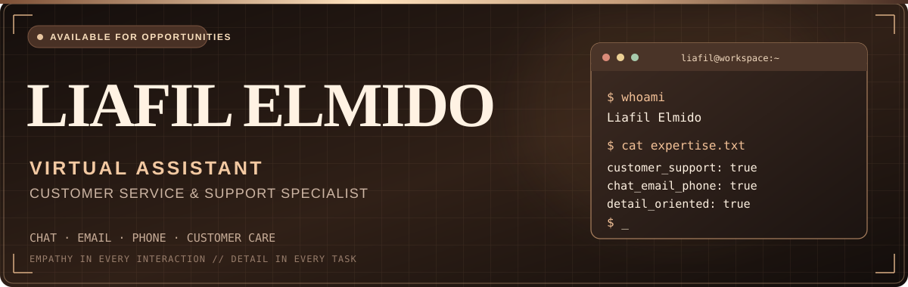
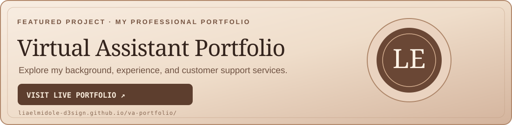
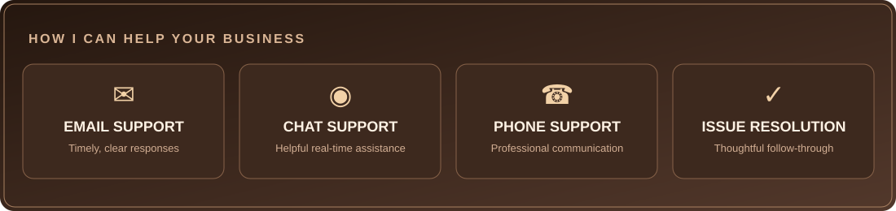
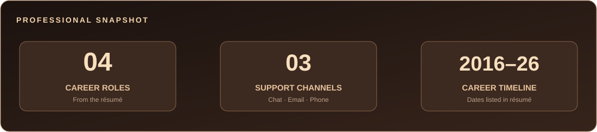
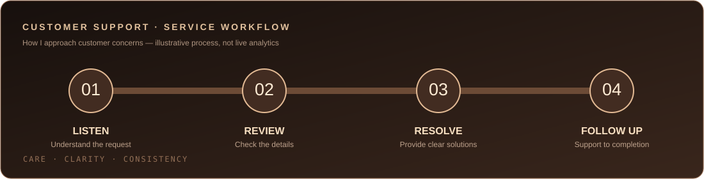
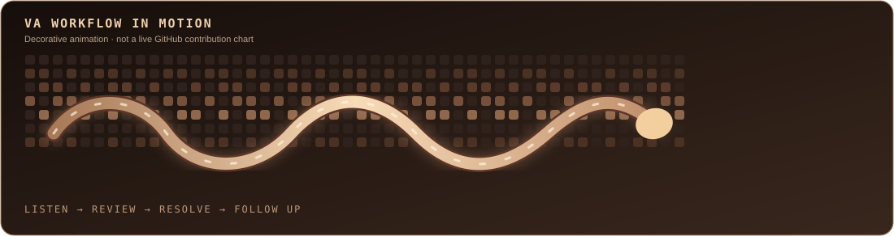

<div align="center">



<br/>

[](https://github.com/liaelmidole-d3sign)

<a href="mailto:liaelmido.le@gmail.com"></a>
<a href="https://liaelmidole-d3sign.github.io/va-portfolio/"></a>

<br/><br/>


</div>


## ☕ `~/about-me`

```text
liafil@workspace:~$ whoami
Liafil Elmido

liafil@workspace:~$ cat professional-profile.txt
name        : Liafil Elmido
github      : @liaelmidole-d3sign
role        : Virtual Assistant / Customer Service Representative
specialty   : Chat • Email • Phone Customer Support
experience  : Customer service across remote and contact-center roles
strengths   : Communication • Attention to Detail • Time Management
support     : Refunds • Account Assistance • Billing • Troubleshooting
approach    : Patient, clear, logical and customer-focused
contact     : liaelmido.le@gmail.com
```

I am a **customer service professional** experienced in managing customer concerns, resolving issues efficiently, and maintaining high-quality service in fast-paced environments. My work includes remote virtual assistant positions and customer care across multiple industries.


## 🌐 `~/live-portfolio`

<div align="center">

<a href="https://liaelmidole-d3sign.github.io/va-portfolio/"></a>

**[Explore my live VA portfolio →](https://liaelmidole-d3sign.github.io/va-portfolio/)**

Customer support background, professional services, work experience and a direct way to reach me.

</div>


## ✨ `~/services`

<div align="center">



</div>

| Service area | How I can help |
|:--|:--|
| 💬 **Chat Support** | Respond to inquiries and guide customers toward solutions |
| 📧 **Email Support** | Provide clear, professional product and account assistance |
| 📞 **Phone Support** | Handle customer concerns, billing questions and account issues |
| ✅ **Customer Resolution** | Assist with refunds, cancellations, basic troubleshooting and follow-through |

## 🧰 `~/professional-toolkit`

<div align="center">


</div>

### Core strengths

`Strong Communication` · `Attention to Detail` · `Logical Problem-Solving` · `Creative Thinking` · `Time Management` · `Work Discipline`


## 💼 `~/work-experience`

| Period | Company | Position |
|:--|:--|:--|
| May – Aug 2026 | **BrightPath Outsourcing (Remote)** | Virtual Assistant — Customer Service |
| Mar 2020 – Jul 2025 | **Commercecore (Remote)** | Virtual Assistant — Customer Service |
| Jun 2019 – Dec 2020 | **Eperformax (Pasay)** | Account Specialist |
| Oct 2016 – May 2019 | **Alorica (Northgate Alabang)** | Customer Service Representative |

<details>
<summary><b>View experience details</b></summary>

**BrightPath Outsourcing / Commercecore** — Delivered customer support by chat, email, and phone; processed refunds, resolved concerns and provided product assistance.

**Eperformax** — Assisted financial and telecommunications customers with login issues, debit card concerns, disputes, plan upgrades and basic troubleshooting.

**Alorica** — Supported healthcare and satellite-radio accounts with billing, enrollment, customer retention, cancellations, refunds and troubleshooting.

</details>

## 🎓 `~/education`

```text
Asian Institute of Computer Studies (Bicutan Branch)
Associate Degree in Computer Science
2012 - 2014
```


## 📊 `~/professional-snapshot`

<div align="center">



</div>

## 📈 `~/service-flow`

<div align="center">



</div>

## 🐍 `~/workflow-in-motion`

<div align="center">



<sub>VA-themed artwork hosted in this repository. Not a live GitHub contributions chart.</sub>

</div>


## 📬 `~/contact`

<div align="center">

**Let's create better customer experiences, one conversation at a time.**

[🌐 View my VA portfolio](https://liaelmidole-d3sign.github.io/va-portfolio/) · [📧 Send an email](mailto:liaelmido.le@gmail.com)

<a href="mailto:liaelmido.le@gmail.com?subject=Virtual%20Assistant%20Opportunity"></a>

<br/><br/>


**YOUR CLIENTS DESERVE GREAT SUPPORT**

<sub>Made with ☕ and dedication by Liafil Elmido.</sub>

</div>
