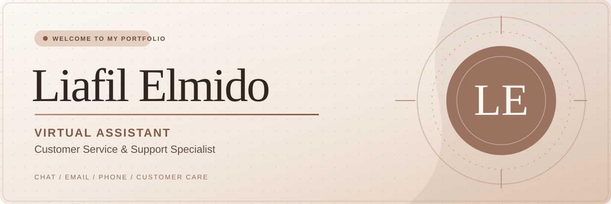

# Hello, I'm Liafil Elmido 👋

**Virtual Assistant | Customer Service Specialist | Remote Support**

I support customers through **chat, email, and phone**, handling inquiries, refunds, product questions, account assistance, and issue resolution with clear communication and attention to detail.

---

## ☕ About Me

I'm an experienced customer service professional who enjoys helping people and finding thoughtful solutions. My background includes remote virtual assistant work and account support for financial, telecom, healthcare, and related service environments.

## ✨ What I Do

- **Customer Support:** Chat, email, and phone communication
- **Issue Resolution:** Refunds, product concerns, account queries, and basic troubleshooting
- **Account Assistance:** Billing, plan changes, customer retention, and disputes
- **Remote Collaboration:** Detail-oriented, dependable, and clear communication

## 💼 Experience

| Role | Company | Period |
| --- | --- | --- |
| Virtual Assistant (Customer Service) | BrightPath Outsourcing · Remote | May–Aug 2026 |
| Virtual Assistant (Customer Service) | Commercecore · Remote | Mar 2020–Jul 2025 |
| Account Specialist | Eperformax · Pasay | Jun 2019–Dec 2020 |
| Customer Service Representative | Alorica · Northgate Alabang | Oct 2016–May 2019 |

## 🧩 Core Strengths

`Chat Support` `Email Support` `Phone Support` `Communication` `Attention to Detail` `Time Management` `Logical Problem-Solving`

## 🎓 Education

**Associate Degree in Computer Science**  
Asian Institute of Computer Studies (Bicutan Branch), 2012–2014

## 📬 Let's Work Together

For virtual assistant and customer support opportunities, contact **[liaelmido.le@gmail.com](mailto:liaelmido.le@gmail.com)**.

---

Portfolio information is based on my professional résumé. This repository includes a responsive website (`index.html`). To publish it, enable GitHub Pages: Settings → Pages → Deploy from a branch → main / (root).
